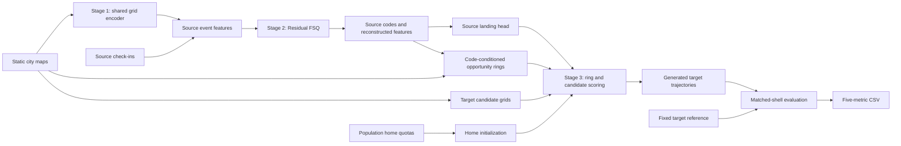

# Code map

Start with `SHAPE/__main__.py` for the command routing, `run_full_pipeline.py` for the four-direction training graph, and
`SHAPE/reproduce.py` for frozen-input generation and scoring.

## Retained modules

| Modules | Responsibility |
|---|---|
| `stage1/grid_text_encoder.py`, `contrastive_trainer.py` | Static grid model and contrastive training; no target trajectories |
| `stage1/train_grid_embeddings.py`, `extract_embeddings.py` | Checkpoint training and int64 ID-keyed embedding extraction |
| `stage2/prepare_city_event_data.py`, `sparse_event_data.py` | Raw parsers, sparse mapping, source event features and user splits |
| `stage2/data.py` | Process-local NPZ loading, padding and attention-budget batching |
| `stage2/model.py`, `rqvae_modules.py`, `tokenizer.py` | Event encoder/decoder, residual FSQ and checkpoint validation |
| `stage2/train_tokenizer.py`, `trainer.py` | Fixed SHAPE CLI, auxiliary losses, training and source validation |
| `stage3/prepare_codes.py`, `source_cohort.py`, `resident_index.py` | Source day archives, train/test source schedules and user/day indexing |
| `stage3/landing_head.py` | Source-supervised 64→20 feature query and checkpoint loading |
| `stage3/source_semantics.py`, `prototype_semantics.py`, `rank_semantics.py` | Source train code backoff, coarse/fine ring distributions and POI attraction |
| `stage3/opportunity_rank.py` | Raw-POI weighted ranks, bounded row caching and source rank/revisit profiles |
| `stage3/context_memory.py`, `sampler.py`, `runtime.py` | Static home matching, hard rings, target scoring, generated-visit memory and threaded seed lanes |
| `stage3/reference.py`, `shell_support.py`, `shell_plan.py`, `matched_shell.py` | Fixed target reference, length support, resampling plans and matched donor days |
| `stage3/metrics.py`, `spatial_metrics.py`, `basic_metrics.py` | OD, spatial/time and individual-distribution evaluation |
| `stage3/group_index.py`, `static_features.py`, `grid_projection.py` | Released static feature repair, grid groups and sparse evaluation projection |
| `stage3/tasks.py`, `SHAPE/shape_contract.json` | Current rank-only mechanism, seed list and evaluation contract |
| `SHAPE/verify.py` | Independent recomputation of the committed 200-draw reference table |

## Release boundaries

Only the fixed SHAPE model and its numerical dependencies are included.
The root `run_full_pipeline.py` orchestrates four-direction verification,
scoring, frozen-input generation, and fresh training. `SHAPE/reproduce.py`
implements the three recorded scoring protocols and their seed semantics.

Some internal array names retain legacy identifiers. In the generation path,
`code_distance_*` probabilities now refer only to opportunity-rank bins.
Stage 2's public training interface accepts the fixed three-layer residual FSQ
configuration with aggregate auxiliary objectives and no layer semantic targets.
Old weights/codes are rejected for generation; archived predictions can still
be scored. See `verification.md` for actual checks and limits.
